# LANGuard 1.7

[](https://github.com/huseyinTozluyurt/LANGuard/actions/workflows/tests.yml)

LAN attack monitor, intrusion prevention and real-time anti-malware for Linux
desktops and laptops on weak or untrusted networks (home Wi-Fi, shared offices,
dorms, cafés). It catches ARP spoofing, rogue DHCP and IPv6 routers, DNS
spoofing, SSL stripping, evil-twin Wi-Fi and LLMNR/Responder poisoning, stops
them on your machine, and scans new files with ClamAV.

Runs on Ubuntu, Debian, Linux Mint, Pop!_OS, Fedora, RHEL/AlmaLinux/Rocky,
openSUSE and Arch (see [Supported distributions](#supported-distributions)).
LANGuard never changes your DNS or dnscrypt-proxy settings, and it is not a VPN.

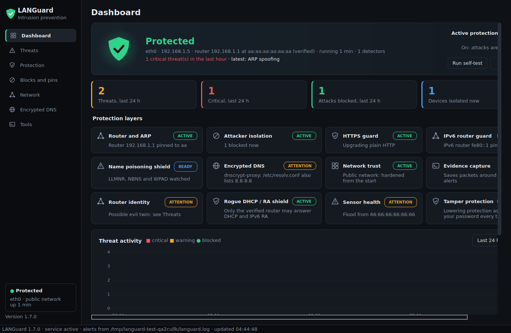

## Quick start

```bash
git clone https://github.com/huseyinTozluyurt/LANGuard.git
cd LANGuard
./install.sh --dry-run          # optional: see what would be installed, changes nothing
sudo ./install.sh --enable      # install and start protection at every boot
languard-gui                    # or open "LANGuard" from the applications menu
```

Or download the ZIP from the green **Code** button on GitHub, extract it and
run the same `install.sh` commands inside the folder. If your distribution
has no (or too old) scapy / PyQt5 package, use `sudo ./install.sh --enable --pip`
(see [Dependencies](#dependencies)). To remove it: `sudo ./uninstall.sh`.

Requirements: Python 3.8+ and root for the install; systemd for always-on protection. About
1 GB of RAM for ClamAV's daemon (skip it with `--no-av`).

## Screenshots

These were taken from the desktop app running inside an Ubuntu 24.04 test
container, fed with simulated attacks by the test suite (so addresses such as
`aa:aa:aa:aa:aa:aa` and `66:66:66:66:66:66` are test values).

| Dashboard | Threats |
|---|---|
|  | 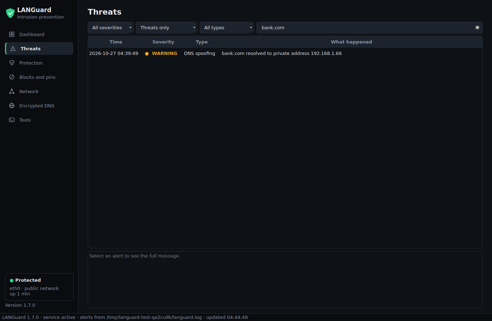 |
| **Protection** | **Blocks and pins** |
| 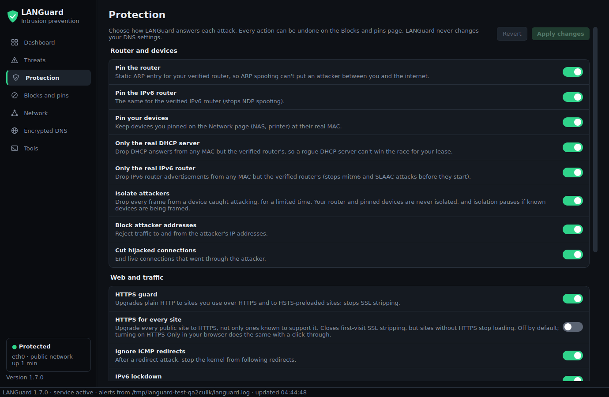 | 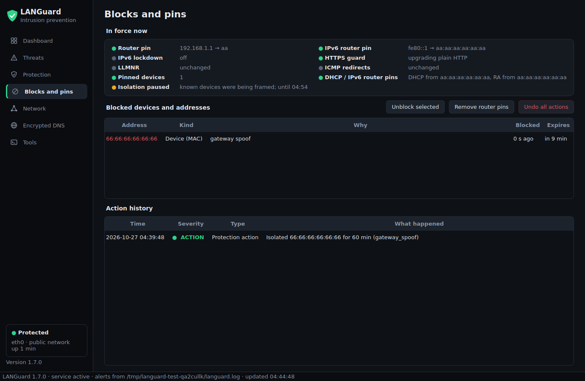 |
| **Network** | **Encrypted DNS (read-only)** |
| 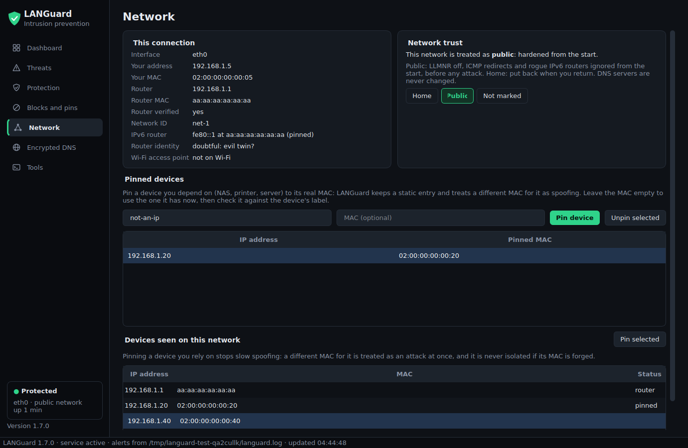 | 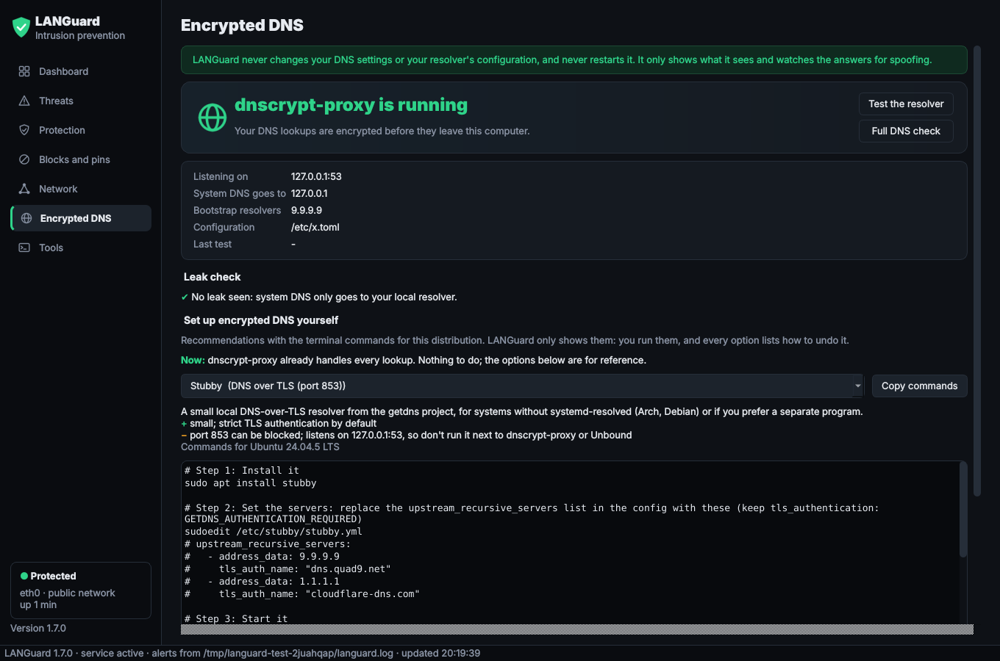 |
| **Tools** | **Encrypted DNS setup guide** |
| 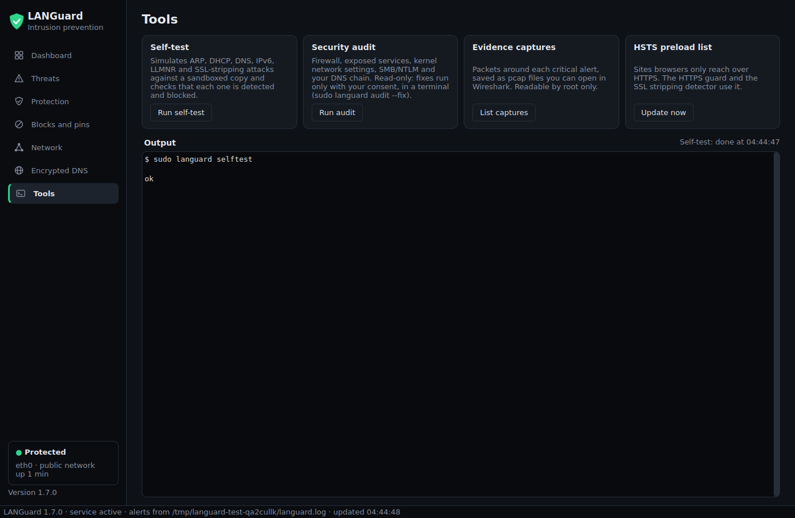 | 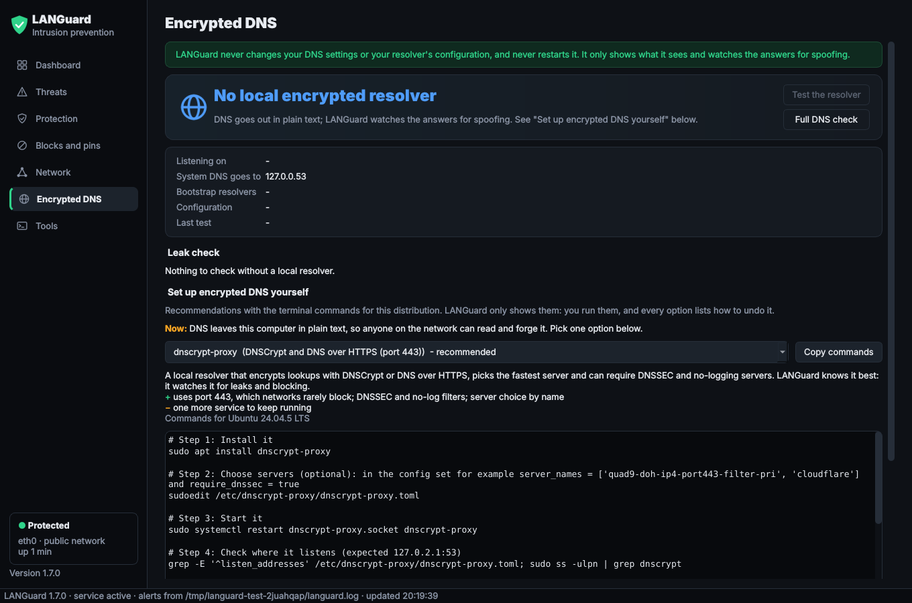 |

## Tested on

Every distribution below was tested in a throwaway container with
`scripts/ci-container-test.sh`, which runs `install.sh --dry-run`, a real
install, the CLI (`--version`, `config`, `status`, `audit`, `selftest`), the
desktop app (offscreen), the whole test suite (14 files) and
`uninstall.sh --purge`.

| Distribution | Dependencies from | Result |
|---|---|---|
| Ubuntu 20.04, 22.04, 24.04 | distribution packages (apt) | all checks passed, desktop app included |
| Ubuntu 20.04, 22.04, 24.04 | `install.sh --pip` (scapy and PyQt5 from PyPI) | all checks passed, desktop app included |
| Arch Linux | offline Python 3.12 + wheels | all checks passed |
| Ubuntu 24.04 with systemd + ClamAV | apt, `--enable` | EICAR test file quarantined in real time, the full scan found it, the guard restarted a stopped ClamAV, uninstall left nothing behind |

The GitHub Actions workflow ([`tests.yml`](.github/workflows/tests.yml)) runs
the same script with real package installs on every push. All of these jobs pass:

| Distribution (GitHub Actions) | Dependencies from | Result |
|---|---|---|
| Ubuntu 20.04, 22.04, 24.04 | apt | passed |
| Debian 12, 13 | apt | passed |
| Fedora 41, 42 | dnf | passed |
| AlmaLinux 9 | dnf + EPEL | passed |
| openSUSE Leap 15.6, Tumbleweed | zypper | passed |
| Arch Linux | pacman | passed |
| Ubuntu 24.04, Debian 12, Fedora 42 | `install.sh --pip` | passed |
| Developer venv, Python 3.8, 3.10, 3.12, 3.13 | `requirements-dev.txt` | passed |

The picture below is from the earlier offline sandbox run, where the
non-Ubuntu images had no package mirrors: there the selftest correctly
reported that nftables was missing. With real mirrors (above) they pass.

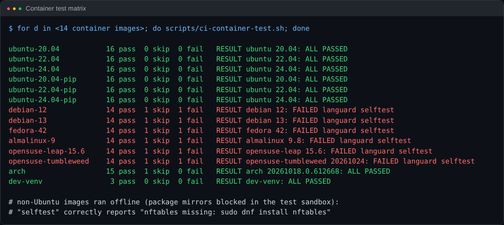

<details>
<summary>One full container run (Ubuntu 24.04) and the ClamAV test</summary>

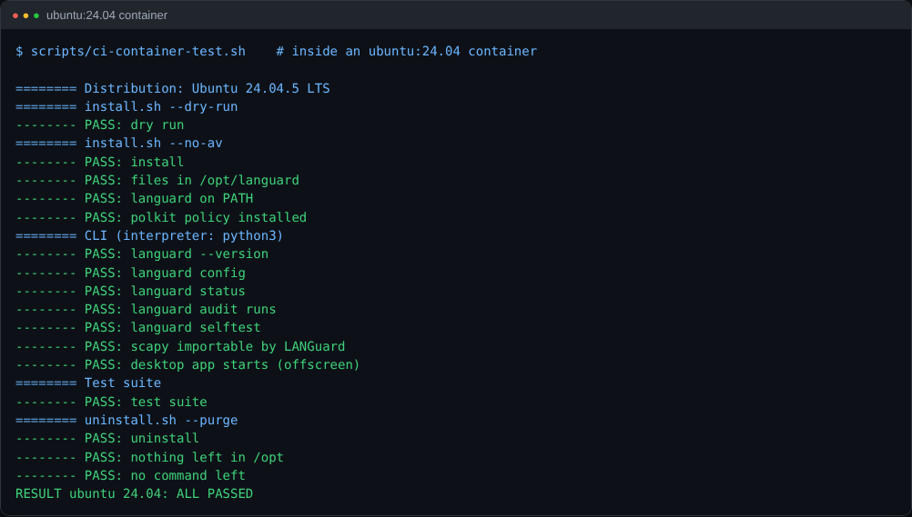

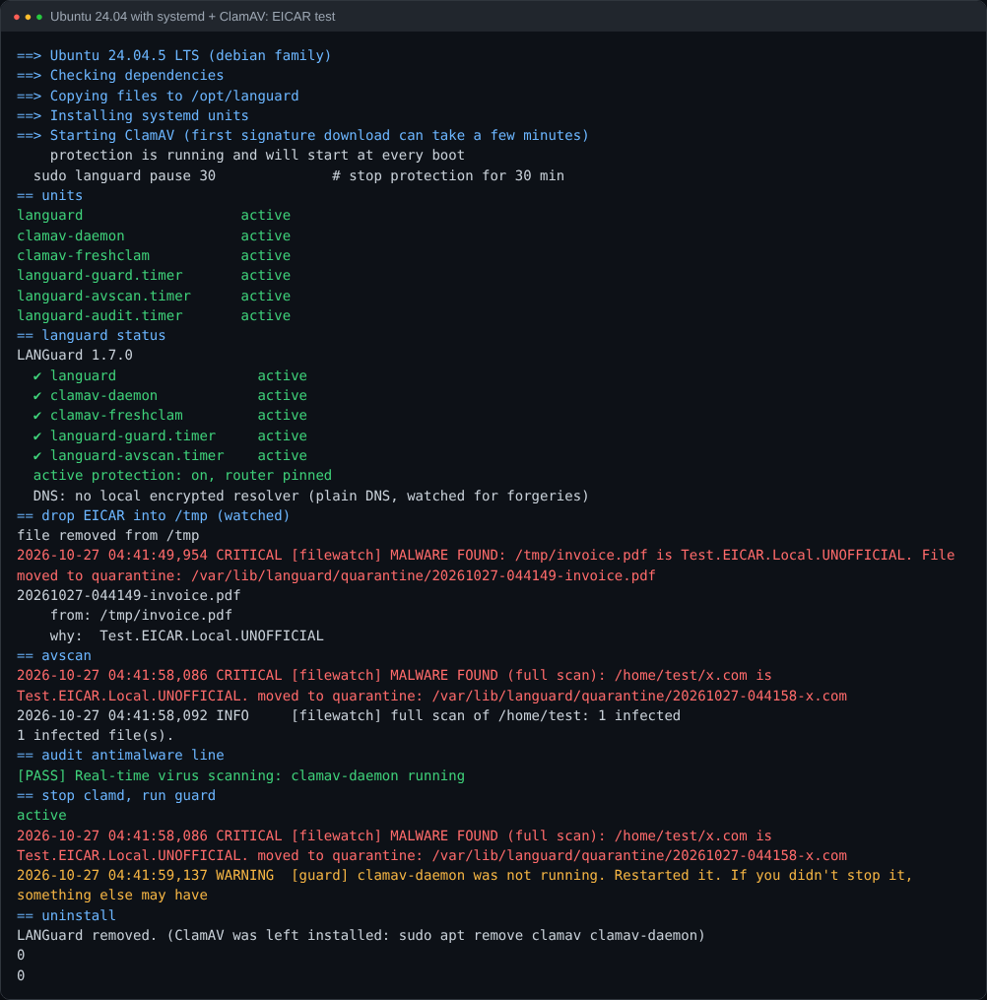

</details>

## What it detects

**Man-in-the-middle and LAN attacks**

| Module | Detects |
|---|---|
| `arp` | ARP spoofing: gateway MAC changes (checked against the router's *verified* MAC, so a cache poisoned before LANGuard started is caught), IP→MAC changes, one MAC posing as many IPs, reply and gratuitous-ARP floods, forged frames, duplicate responders |
| `ipv6` | Rogue Router Advertisements (SLAAC MITM), rogue DHCPv6 (mitm6), NDP spoofing, ICMPv6 redirects. IPv6 routers and DHCPv6 servers are trusted only when they are your *verified* router (or listed in the config), never because they showed up first |
| `mitm` | ICMP redirects; LLMNR/NBT-NS/mDNS poisoning (Responder) via a bait-name honeypot; one device taking over several `.local` names (mDNS spoofing of printers, shares, AirPlay) |
| `netid` | Evil twins and router clones: the Wi-Fi security and access points each network was seen with (a known network that turns open or weaker is CRITICAL), and the router's HTTPS certificate (a box that copied the router's MAC can't copy its key). Shows how far the router is trusted: verified+key, verified, first contact or doubtful |
| `path` | Extra hop between you and your router (an ARP/NDP spoofer forwarding your traffic), via TTL=1 probes and gateway TTL tracking |
| `tls` | HTTPS interception (fake or changed certificates) and SSL stripping (http no longer redirecting to https), every 5 minutes on well-known sites plus the sites you use most, and at once when `strip` sees a stripping sign. Pauses during a captive portal |
| `strip` | SSL stripping in real time, on your own browser traffic: a plain-HTTP request to a site you normally use over HTTPS (or an HSTS-preloaded one) that isn't redirected to HTTPS, a plain-HTTP login POST, any password sent over plain HTTP, or a look-alike name such as `google.corn` or `wwww.example.com` (sslstrip2/hstshijack) |
| `dhcp` | Rogue DHCP servers (trusted by IP *and* MAC, so one posing as your router is caught), fake gateways, changed DNS servers, DHCP starvation (by the client MAC inside the packet), WPAD proxy injection |
| `dns` | Spoofed replies (wrong source, conflicting answers, unsolicited), public names → LAN IPs, WPAD answers, over IPv4 and IPv6. With dnscrypt-proxy running: any plain-DNS lookup that still leaves this machine (a leak) |
| `localdns` | Your own encrypted DNS resolver (dnscrypt-proxy, stubby, cloudflared, dnsproxy): read-only. Warns when lookups can bypass it, when it stops, and when it can't get answers any more (encrypted DNS being blocked) |
| `devices` | Unknown devices joining, MAC flooding (switch CAM overflow) seen in any frame, including macof |
| `scan` | Port scans, NULL/FIN/XMAS stealth scans, SSH/RDP/SMB brute force; optional UFW auto-block |
| `wifi` | Deauthentication floods and evil-twin access points (monitor-mode adapter) |

**Real-time anti-malware**

| Module | Detects |
|---|---|
| `filewatch` | Every new file in Downloads, Desktop, /tmp, /var/tmp, /dev/shm is scanned by ClamAV (clamd, milliseconds per file) and quarantined if infected. Flags disguised files (`invoice.pdf.sh`, right-to-left-override names, `.desktop` launchers) and executables dropped in temp folders. Watches persistence locations (cron, systemd units, autostart, `.bashrc`/`.profile`, `authorized_keys`, `ld.so.preload`, sudoers, apt sources, `/etc/hosts`) and alerts on any change, which catches malware no signature knows yet |
| `host` | Programs running from temp folders, programs that deleted their own file, fileless (memfd) programs, new services suddenly listening on the LAN (backdoors) |
| `avscan` | Weekly full scan of home folders (timer, low priority) |
| `audit` | Firewall, exposed services, SSH, kernel network settings, LLMNR/mDNS, SMB signing and NTLM (relay attacks), whether all DNS goes through your encrypted resolver, Wi-Fi security, ClamAV/LANGuard health, gateway ARP pin, auto-updates |

Each network you join gets its own baseline (router MAC, DHCP servers, DNS
servers, IPv6 routers), so home, office and café values never mix. The router's
MAC is only trusted after repeated ARP probes are each answered by a single
device. `languard baseline` shows them; after replacing your router run
`sudo languard baseline --reset`.

## Your DNS stays yours (dnscrypt-proxy)

LANGuard never changes DNS settings: not `/etc/resolv.conf`, not
systemd-resolved's servers, not NetworkManager connections, not
dnscrypt-proxy's config, and it never restarts or signals dnscrypt-proxy. You
set DNS up; LANGuard checks that it holds on hostile networks:

- `languard dnscheck` (and `languard status`, the app, `audit`) shows which
  resolver runs, where it listens (`127.0.2.1:53` with Ubuntu's package) and
  whether every lookup goes through it. The usual hole: systemd-resolved
  forwards to dnscrypt-proxy, but the Wi-Fi connection also hands resolved
  the network's DNS server from DHCP, and resolved asks that one too, in plain
  text, where a man in the middle can forge the answer. LANGuard names it and
  prints the command that closes it (`nmcli connection modify "<connection>"
  ipv4.ignore-auto-dns yes ipv6.ignore-auto-dns yes`); running it is up to you.
- A plain-DNS lookup that actually leaves this machine while dnscrypt-proxy
  runs raises a **DNS LEAK** warning (once per server per hour). Lookups
  dnscrypt-proxy itself makes to its `bootstrap_resolvers`, local names
  (`.lan`, `.local`, ...) and servers in `dns.plain_ok` are not leaks.
- Every 5 minutes it asks dnscrypt-proxy (on loopback) for a random name. Three
  failures in a row while online raise a warning: blocking encrypted DNS is
  how an attacker pushes machines back to plain DNS. Don't "fix" it by
  switching to the network's DNS on an untrusted network. `"localdns":
  {"probe_interval": 0}` turns the check off.
- Responses that touch name resolution stay small: after an attack the
  systemd-resolved cache is flushed (dnscrypt-proxy's own cache is left alone:
  its answers are authenticated) and LLMNR, which is not DNS (local-name
  broadcast that Responder poisons), is turned off on the interface at
  runtime. `"protect": {"flush_dns": false, "llmnr_off": false}` turns either
  off.

## Setting up encrypted DNS yourself (`languard dnsguide`)

LANGuard doesn't encrypt your DNS for you (it never changes DNS settings), but
it shows you how, with the commands for your distribution. Run
`languard dnsguide`, or open **Encrypted DNS** in the app. It shows what your
DNS does now, recommends an option, and lists each step with **Copy commands**
and the commands to undo it. Nothing is run for you.

| Option | Protocol | Good for |
|---|---|---|
| DNS over TLS with systemd-resolved | DoT, port 853 | Ubuntu, Fedora: nothing extra to install, one config file |
| dnscrypt-proxy | DNSCrypt / DNS over HTTPS, port 443 | networks that block port 853; DNSSEC and no-log server filters. LANGuard watches it most closely |
| Stubby | DoT, port 853 | a small separate resolver (Arch, Debian; not packaged for openSUSE) |
| Unbound | DoT forwarder with local DNSSEC validation | people who want a validating, caching resolver |
| DNS over HTTPS in the browser | DoH, port 443 | the browser only, no terminal |

```bash
languard dnsguide                          # what runs now, and every option
languard dnsguide --option resolved-dot    # one option: resolved-dot, dnscrypt-proxy,
                                           #   stubby, unbound, browser-doh
languard dnsguide --distro fedora          # commands for another distribution
```

For example, DNS over TLS with systemd-resolved on Ubuntu or Fedora:

```bash
sudo mkdir -p /etc/systemd/resolved.conf.d
sudo tee /etc/systemd/resolved.conf.d/dns-over-tls.conf <<'EOF'
[Resolve]
DNS=9.9.9.9#dns.quad9.net 149.112.112.112#dns.quad9.net 1.1.1.1#cloudflare-dns.com 1.0.0.1#cloudflare-dns.com
DNSOverTLS=yes
Domains=~.
FallbackDNS=
EOF
sudo systemctl restart systemd-resolved
# stop the Wi-Fi connection from adding the network's plain DNS servers:
nmcli connection modify "<connection>" ipv4.ignore-auto-dns yes ipv6.ignore-auto-dns yes
nmcli connection up "<connection>"
languard dnscheck                          # check it
```

Pick one option: dnscrypt-proxy, Stubby and Unbound each answer on this
computer, so running two at once breaks DNS. Afterwards LANGuard checks that
every lookup goes through the encrypted resolver and warns when it leaks,
stops or is blocked (see above). The providers in the examples (Quad9,
Cloudflare) can be swapped for any you trust.

## SSL stripping and captive portals

`strip` learns which hosts this machine reaches over HTTPS (from the server
name in each TLS handshake; only host names are stored, in
`/var/lib/languard/strip.json`) and watches the first bytes of plain-HTTP
requests. Only browser requests are judged, so apt, updaters and certificate
revocation checks never alert. Add hosts that must never be plain HTTP with
`"strip": {"sites": ["mybank.example"]}`.

Every site on the HSTS preload list (Mozilla's, about 125,000 sites that
browsers only ever reach over HTTPS) counts as an HTTPS site too, even if
this machine never visited it, both for detection and for the HTTPS guard.
The list is downloaded over HTTPS at install and refreshed weekly by
`languard-guard.timer`; `sudo languard hsts --update` refreshes it now. Without
it a short built-in list of big sites is used.

Captive portals (hotel and café logins) hijack plain HTTP and break HTTPS,
which looks exactly like an attack. When LANGuard finds a portal on joining
a network, HTTPS checks wait and `strip` findings are logged as INFO until you
log in, for at most 20 minutes. A portal that appears later on a network
that already had normal internet raises a WARNING instead, and checks keep
running, because an attacker could fake one to silence alerts.

Configs from 1.2 don't list `strip` in `modules`; it starts automatically
with `tls`. To turn it off, add `"modules_off": ["strip"]`. The same goes for
`localdns` (1.6), which only reads.

## Active protection (on by default since 1.4)

LANGuard stops attacks as well as reporting them. Configs written by 1.3 or
older have `"enabled": false`; turn it on with `sudo languard protect --on`
(or the switch in the app). `"enabled": false` turns every response off and
LANGuard only alerts.

| Setting | Default | What it does |
|---|---|---|
| `pin_gateway` | on | Permanent ARP entry for the verified router MAC, which ARP spoofing can't overwrite. Restored within 30 s if anything changes it |
| `isolate` | on | Drops every frame (ARP, IPv4, IPv6) from a confirmed attacker's MAC with nftables, before the kernel processes it. Expires after `isolate_minutes` (60) |
| `isolate_max` | 3 | If more devices than this are named as attackers within 10 minutes, isolation pauses for 30 minutes (see Safety) |
| `repair_dhcp` | on | If a rogue DHCP or DHCPv6 (mitm6) server took over this machine's gateway or DNS, renews the connection from the real server and flushes the DNS cache |
| `ipv6_lockdown` | on | After a rogue Router Advertisement: removes its routes and stops accepting RAs on the interface (IPv4 unaffected) |
| `https_guard` | on | Stops SSL stripping: plain-HTTP requests from your browser to sites you use over HTTPS (and big HSTS-preloaded sites) are redirected to https:// on this machine, before anything is sent; look-alikes of those sites get a warning page instead. Everything else passes unchanged |
| `block_ips` | on | Rejects everything this machine sends to an attacker's IP addresses and drops everything from them (nftables `inet languard_ip`). Expires after `isolate_minutes` |
| `block_max` | 20 | If more addresses than this are to be blocked within 10 minutes, IP blocking pauses for 30 minutes |
| `never_block` | [] | IP addresses never to block (the router and this machine never are) |
| `cut_connections` | on | Ends live connections that went through the attacker or to a forged address (`ss -K`), so apps reconnect over the clean path |
| `flush_dns` | on | Empties the DNS cache after DNS spoofing or any MITM, so forged answers are gone |
| `llmnr_off` | on | After LLMNR/NBT-NS poisoning (Responder): turns LLMNR off on the interface until undo or the next reconnect |
| `block_redirects` | on | After an ICMP redirect attack: the kernel stops accepting redirects and the routes they created are dropped |
| `block_wpad` | on | A LAN host handed out as a WPAD proxy (DHCP option 252 or a `wpad` DNS answer) is blocked: it would see all your web traffic |
| `pin_devices` | on | Devices you pin (`sudo languard protect --pin-device IP [MAC]`, e.g. a NAS or printer) get a permanent ARP entry like the router; anyone else claiming their address is isolated (DEVICE SPOOFING) |
| `pin_router6` | on | The verified IPv6 router gets a permanent NDP entry too |
| `public_hardening` | on | On a network marked public (`sudo languard network --public`) or open Wi-Fi: ICMP redirects ignored, LLMNR off and (with no known IPv6 router) router advertisements ignored from the start, not only after an attack. Put back on networks marked `--home`. Runtime only; DNS servers are never changed |
| `pin_dhcp` | on | Once the router is verified, DHCP answers from any other MAC are dropped in the nftables netdev table, so a rogue DHCP server can't win the race for your lease (it is still detected and reported) |
| `pin_ra` | on | The same for IPv6 router advertisements: only the verified router (and `ipv6.trusted_routers`) may advertise itself |
| `https_only` | off | Upgrade *every* public site to HTTPS, not only known ones: closes first-visit SSL stripping, but sites without HTTPS stop loading. Your browser's HTTPS-Only mode does the same with a click-through (the audit checks it) |
| `kill_switch` | off | Disconnects the interface on a confirmed gateway man-in-the-middle: two different signs of it (e.g. ARP spoofing and a rogue DHCP answer) from the same attacker within 2 minutes, so one forged packet can't take you offline |

How the HTTPS guard works: an nftables rule sends this machine's outgoing
port-80 connections to a local proxy on 127.0.0.1/::1 port `guard_port`
(8079), which nothing on the LAN can reach. It never touches apt and other
non-browser clients, certificate checks (OCSP/CRL), captive-portal checks, or
anything while a captive portal is active. The rule is removed when the
service stops. Sites you have never used over HTTPS can still be stripped on
a first visit; Firefox's or Chrome's "HTTPS-Only" setting closes that too.

What each confirmed attack triggers:

| Attack | Responses |
|---|---|
| ARP spoofing of the router | isolate the attacker, block the IPs it used as its own (never ones it only claimed), re-pin the router, end every connection that left through the router, flush DNS |
| Spoofing a pinned device (NAS, printer) | isolate the spoofer, re-pin the device, end connections to it |
| WPAD proxy injection | block the proxy host (LAN addresses only, never the router) |
| Extra hop in front of the router (`path`) | isolate the hop, end connections through it, flush DNS |
| Rogue DHCP server | isolate it, block its on-LAN addresses (server, fake gateway, fake DNS), end connections to them, renew the lease, flush DNS |
| Rogue IPv6 router (RA) / NDP spoofing of the router | isolate it, IPv6 lockdown, end routed IPv6 connections, flush DNS |
| Rogue DHCPv6 server (mitm6) | isolate it, block its addresses, end connections, renew, flush DNS |
| LLMNR/NBT-NS poisoning (Responder) | isolate it, block its IP, end connections to it, LLMNR off, flush DNS |
| ICMP redirect from a non-router | isolate it, block its IP, stop accepting redirects, drop redirected routes |
| DNS spoofing (reply from the wrong IP or not from your router's MAC) | isolate the sender, block the forged addresses and end connections to them, flush DNS |
| Conflicting DNS answers | flush DNS, end connections to both answers so they reconnect after a fresh lookup |
| SSL stripping | HTTPS guard upgrades the request before it leaves; if one gets through, its plain-HTTP connection is ended |
| Look-alike of an HTTPS site | warning page instead of the site, its address blocked |
| TLS interception | flush DNS; kill switch if you turned it on |
| Port scan / brute force | scanner's IP blocked (expires; never the router) |
| Evil twin Wi-Fi (`wifi`) | disconnect if this machine is associated with it |
| DHCP starvation | isolate the flooding MAC |
| Any CRITICAL alert | packets from the 60 s before to 5 s after saved as a pcap (`sudo languard evidence`) |

Two attacks can only be reported: MAC flooding of the switch (the attacker
uses random addresses, so there is nothing to block; a managed switch with
port security stops it) and Wi-Fi deauthentication floods (needs 802.11w /
WPA3 on the access point).

Safety: nothing is pinned or isolated until the router's MAC is verified on the
current network. An attacker can forge another device's MAC to get it
isolated; isolation only drops that device's frames on this machine (it keeps
working for everyone else) and expires, and naming more than `isolate_max`
devices in 10 minutes pauses isolation and raises a CRITICAL alert. The pin,
IPv6 lockdown, DHCP repair, IP blocks, ended connections, LLMNR and
redirect settings and HTTPS guard only change this machine's own traffic and
settings, so they can't be used against other devices; IP blocking has its
own limit (`block_max`). The router, this
machine, every device the network baseline trusts and `never_isolate` are
never isolated. Pins and isolations from a
previous network are dropped when you move.

```bash
sudo languard protect                       # what is pinned / isolated now
sudo languard protect --unblock MAC         # or: --unblock all
sudo languard protect --unpin               # remove the router pin
sudo languard protect --undo-all            # undo everything
sudo languard protect --on | --off          # switch active protection
sudo languard protect --set https_guard=off kill_switch=on   # single responses
sudo languard protect --pin-device 192.168.1.20 [MAC]   # pin a NAS/printer
sudo languard protect --unpin-device 192.168.1.20
sudo languard network --home | --public | --unmark      # what this network is
```

## Hardening against a skilled attacker (1.7)

1.7 closes the ways a professional attacker would get around 1.6:

* **Evil twin and router clones**: `netid` remembers each network's Wi-Fi
  security, access points and the router's HTTPS key. A known network that
  shows up open or weaker is an evil twin (CRITICAL, and LANGuard
  disconnects from it); a different router key means a different box. On a
  network you visit for the first time nothing can be compared, and the app
  says so ("first contact") instead of showing it as verified.
* **Framing innocent devices**: your router, pinned devices and trusted
  devices are never isolated, even if their MAC is forged into an attack
  (you get a warning instead). Made-up MACs never seen before are isolated
  without counting toward `isolate_max`; only known devices pause isolation,
  and while it is paused LANGuard tightens instead (redirects ignored, LLMNR
  off, IPv6 router advertisements ignored).
* **Malware reusing your password**: commands that lower protection
  (pause, `--off`, `--undo-all`, `--unblock`, `--unpin`, `--set X=off`,
  `network --home`, `baseline --reset`, …) go through
  `/opt/languard/languard_strict.py`, a polkit action that asks for your
  password every time. Through the normal entry point (password kept for a
  few minutes) they are refused. Every one of them, however it was run, raises
  a "PROTECTION LOWERED" alert naming the user and the program that asked.
* **Blinding the sensor**: each source MAC gets at most `sensor.per_mac_pps`
  (200) packets a second into the detectors, so a flood only wastes the
  flooder's budget. Kernel drops on the capture socket ("SENSOR OVERLOADED"),
  floods and detector errors on crafted packets are reported and shown in
  the app. The service runs with a tighter systemd sandbox.
* **Rogue DHCP / IPv6 router races**: `pin_dhcp` and `pin_ra` drop those
  answers from anyone but the verified router before the kernel sees them.
* **Kill switch as a denial of service**: it needs two different signs of
  the attack; the router's own MAC never triggers it.
* **First-visit SSL stripping**: a password sent over plain HTTP is
  reported, `https_only` upgrades every site, and the audit checks whether
  your browser's HTTPS-Only mode is on.
* **Slow spoofing**: the app lists the devices seen on the network; pin the
  ones you rely on and any other MAC for them is an attack at once.

## Evidence

On every CRITICAL alert (at most one a minute) the packets LANGuard captured
from 60 seconds before to 5 seconds after are saved to
`/var/lib/languard/evidence/<time>-<module>.pcap` with a `.txt` note, readable
by root only. Open them in Wireshark. The oldest are deleted beyond
`evidence.max_mb` (200); `"evidence": {"enabled": false}` turns it off.

## Selftest

`sudo languard selftest` checks the tools protection needs (nftables, `ss -K`
kernel support, scapy, NetworkManager, resolvectl), your encrypted DNS and the
HSTS list, then feeds every detector the packets of each attack (ARP and
device spoofing, rogue DHCP/DHCPv6/RA, DNS forgery, SSL stripping, look-alike
sites, Responder, WPAD, forged-MAC framing, made-up MACs, framing the
router, DHCP/RA pinning, tamper protection, a DNS leak) with a fake command
runner, so every response is checked and nothing on your machine changes.
The last check proves no response would change your DNS settings.
`--netns` also runs the HTTPS guard and IP blocking for real in a throwaway
network namespace.

An attacker can change their MAC, and a DHCP client that reads every raw
packet (older `dhclient`) sees them before any firewall, so isolation and
DHCP pinning narrow attacks rather than making them impossible. The alerts stay on either way.

## Desktop app

`languard-gui` (or **LANGuard** in the applications menu) is an intrusion
prevention console you run as your normal user. A sidebar leads to:

- **Dashboard**: a status shield (**Protected**, **Monitoring** (alerts only),
  **Paused**, **Not running**), the **Active protection** switch, **Pause**
  (15 min, 1 h, 8 h, until you resume) / **Resume**, **Run self-test**, 24-hour
  counters, eight protection layers (router/ARP, attacker isolation, HTTPS
  guard, IPv6 router guard, name poisoning, encrypted DNS, network trust,
  evidence) each marked Active, Ready, Off or Attention, threat activity over
  time, threats by type and the latest critical alerts
- **Threats**: every alert and action, filterable and searchable, with details
- **Protection**: a switch for every response (router pin, isolation, IP
  blocks, cutting hijacked connections, HTTPS guard, ICMP redirects, IPv6
  lockdown, DHCP repair, LLMNR, WPAD, DNS cache flush, public-network
  hardening, kill switch). Changes are saved with **Apply changes**
  (`languard protect --set KEY=on|off`); switching one off undoes only what
  that response did
- **Blocks and pins**: what is in force now, blocked MACs and IPs with
  **Unblock**, **Remove router pins**, **Undo all actions**, and the action
  history
- **Network**: this connection and whether the router is verified, **Home** /
  **Public** / **Not marked**, and pinned devices (add with an optional MAC,
  remove)
- **Encrypted DNS**: a setup guide with terminal commands for dnscrypt-proxy,
  DNS over TLS, Stubby, Unbound and browser DoH (copy, never run), and your
  dnscrypt-proxy (or other local resolver), where it
  listens, what system DNS goes to, leaks, a live resolver test and the full
  `dnscheck`. Read-only: the app never changes DNS either
- **Tools**: self-test, security audit (results table; fixes only with your
  consent in a terminal), evidence captures, HSTS list update
- a tray icon whose colour follows the protection state, with a desktop
  notification for each new critical threat

Buttons that change something ask for your password through polkit, once per
few minutes; the audit, DNS check and resolver test run as you. The app reads
the service's live status from `/run/languard/status.json` and alerts from
`/var/log/languard.log` (or `json_log` when set). Install skips it with
`--no-gui`.

## Always on

- `languard.service` restarts on crash, on hang (systemd watchdog, 90 s) and on
  any exit, with no restart limit. It's shielded from the out-of-memory killer
  and survives Wi-Fi drops and IP changes.
- An internal supervisor restarts the whole service if any detector thread
  dies, and errors inside a single check never stop that detector.
- `languard-guard.timer` checks every 5 minutes that LANGuard and ClamAV's
  daemon and signature updater (whatever your distribution calls them) are running, restarts them, and raises a **CRITICAL alert if
  someone stopped protection**. It also warns when virus signatures are older
  than 3 days.
- To stop it on purpose without triggering alerts: `sudo languard pause 30`
  (resumes automatically) or `sudo languard resume`.

## Install / update

```bash
git clone https://github.com/huseyinTozluyurt/LANGuard.git && cd LANGuard
sudo ./install.sh --enable      # updates keep it enabled; --no-av skips ClamAV, --no-gui the app
```

`./install.sh --dry-run` shows what it would install and change, without
changing anything (no root needed). `--no-deps` skips the package manager
when you installed the dependencies yourself.

The installer recognises your distribution from `/etc/os-release` and uses
its package manager (apt, dnf, zypper or pacman) and package names. It
installs only what LANGuard needs: Python 3.8+, scapy, nftables, iproute2,
notify-send, the IEEE vendor list, PyQt5 and polkit for the app, and ClamAV.
It never installs, removes or reconfigures DNS software: your DNS servers,
systemd-resolved settings and dnscrypt-proxy stay exactly as they are.

### Dependencies

LANGuard has two kinds of dependencies, and they come from different places:

| What | Why | Where it comes from |
|---|---|---|
| Python 3.8+ | everything | your distribution (Leap 15 / RHEL 8: `python311` / `python3.11`) |
| scapy (`requirements.txt`) | packet capture for the LAN detectors | distribution package first, PyPI as the fallback |
| PyQt5 (`requirements-gui.txt`) | the desktop app | distribution package first, PyPI as the fallback |
| nftables, iproute2 (`ip`, `ss`) | blocking, isolation, router pinning, cutting connections | distribution only |
| ClamAV (daemon + freshclam) | real-time virus scanning | distribution only (optional: `--no-av`) |
| polkit (`pkexec`), notify-send, IEEE OUI list | app password prompts, desktop alerts, vendor names | distribution only |

The strategy:

1. **Distribution packages first.** The service runs as root, so its
   libraries should get security updates with the rest of the system
   (`apt upgrade`, `dnf upgrade`...). `install.sh` installs them with your
   package manager.
2. **PyPI as the fallback, isolated.** When the distribution has no scapy or
   PyQt5 for the Python LANGuard uses (RHEL without EPEL, Leap's newer Python),
   or when you ask for it with `sudo ./install.sh --pip`, the installer runs
   `pip install --target /opt/languard/vendor -r requirements.txt` (and
   `requirements-gui.txt`). Nothing goes into the system's site-packages, so it
   can't break your distribution's Python (PEP 668), and `uninstall.sh`
   removes it with the rest of `/opt/languard`. A distribution package, when
   present, still wins over the vendored copy. For a PyQt5 wheel the installer
   also adds the few system libraries it needs (OpenGL, xkbcommon, fontconfig).
   Re-run `sudo ./install.sh --pip` to update the vendored libraries.
3. **Never `sudo pip install` into the system.**
4. **Development in a virtual environment:**

   ```bash
   python3 -m venv --system-site-packages .venv   # reuses distro scapy/PyQt5 if present
   .venv/bin/pip install -r requirements-dev.txt  # + pyflakes, shellcheck
   tests/run_all.sh .venv/bin/python
   ```

### Supported distributions

| Distribution | Packages | ClamAV units | Notes |
|---|---|---|---|
| Ubuntu 20.04, 22.04, 24.04+, Linux Mint 21/22, Pop!_OS, Debian 11/12/13 | apt | `clamav-daemon`, `clamav-freshclam` | the reference platform |
| Fedora 40+ | dnf | `clamd@scan`, `clamav-freshclam` | turns on clamd's local socket in `/etc/clamd.d/scan.conf`; with SELinux enforcing, sets `antivirus_can_scan_system` |
| RHEL / AlmaLinux / Rocky 9 | dnf | `clamd@scan`, `clamav-freshclam` | ClamAV and PyQt5 come from EPEL; without EPEL, scapy is fetched from PyPI into `/opt/languard/vendor` and the app is skipped |
| openSUSE Tumbleweed | zypper | `clamd`, `freshclam` | |
| openSUSE Leap 15 | zypper | `clamd`, `freshclam` | its `python3` is 3.6: the installer uses `python311` (installs it if needed) |
| Arch, Manjaro, EndeavourOS | pacman | `clamav-daemon`, `clamav-freshclam` | no IEEE vendor list package (vendor names come from Wireshark's list if installed); keep the system updated with `pacman -Syu` |

Firewall checks in `languard audit` understand UFW (Debian/Ubuntu/Arch) and
firewalld (Fedora/RHEL/openSUSE); the update check knows unattended-upgrades
and dnf-automatic. On distributions where `sudo` doesn't search
`/usr/local/bin` (RHEL-likes), the installer also links `/usr/bin/languard`.
systemd is required for always-on protection; without it the installer
skips the services and `sudo languard monitor` can be run from your own init
system.

ClamAV's daemon uses about 1 GB of RAM. Without it (`--no-av`) the heuristics
and persistence watch still run. The first signature download takes a few minutes.

## Everyday commands

```bash
languard status                    # health, quarantine count, latest alerts
journalctl -u languard -f          # live alerts
sudo languard audit [--fix]        # hardening check; --fix asks before LLMNR/mDNS off and Samba signing
languard dnscheck                  # is every lookup going through dnscrypt-proxy?
languard dnsguide                  # how to set up encrypted DNS (commands, never run)
sudo languard selftest             # simulated attacks, nothing changed
sudo languard evidence             # pcaps saved on critical alerts
sudo languard hsts --update        # refresh the HSTS preload list
sudo languard tls --once           # HTTPS interception check right now
sudo languard quarantine           # list; --restore ID to undo a false positive
sudo languard avscan ~/Downloads   # on-demand scan
sudo languard devices --list       # LAN inventory (--learn, --trust MAC)
sudo languard dhcp --probe         # every DHCP server that answers
languard baseline                  # per-network router/DHCP/DNS baselines
sudo languard protect              # active protection status and undo
```

Alerts go to the journal, `/var/log/languard.log`, desktop popups
(`"notify": true`) and optionally JSON lines (`json_log`) for a SIEM.

## Tuning

Everything lives in `/etc/languard/config.json`. Unset keys use defaults, and
`languard config` shows the effective values.

- `modules`: which detectors the service runs.
- `filewatch.scan_dirs` / `filewatch.ignore` (glob patterns) / `max_scan_mb`.
- `host.ignore_exes`: glob patterns for programs you trust (for example an app
  that legitimately runs from memory).
- `ipv6.trusted_routers`: IPv6 routers that aren't your verified router.
  `sudo languard baseline --reset` relearns (keeps home/public marks and
  pinned devices).
- `dns.plain_ok`: servers that may get plain DNS next to dnscrypt-proxy (an
  app that uses its own DNS on purpose).
- `devices.frame_flood_threshold`: unknown source MACs in 10 s that count as a
  MAC flood (500). Raise it on very large networks.
- `tls.sites`: sites used for the interception check. The learned issuers
  live in `/var/lib/languard/tls.json`.

**Expected false positives:** persistence alerts when *you* add an autostart
app or edit `.bashrc` (they're only INFO while apt/dpkg/snap is installing),
"IP changed MAC" after DHCP reassignments, a TLS issuer change when a site
switches certificate authority, a "rogue IPv6 router" when your network has
an IPv6 router that isn't your IPv4 router (add its MAC to
`ipv6.trusted_routers`).

## Not included: VPN

LANGuard doesn't set up a VPN. On a network you don't trust, a VPN (or
Tor) is still the only thing that also hides *which* sites you visit from
someone in the middle; LANGuard's job is to catch and stop the attacks.

## Limits

On a switched network one host sees broadcast traffic plus its own. That covers
ARP, NDP, DHCP, router advertisements, name poisoning and attacks on this
machine, but not traffic between two other hosts. On a network you join for
the first time there is nothing to compare the router with: an evil twin
that is already there when you arrive (with the right security) can't be told
from the real hotspot. LANGuard can't secure the switch or the access point
themselves (MAC flooding, 802.1X, port security), nor protect other devices
on the network from each other. The anti-malware layer
complements, but does not replace, keeping your system updated and not running
untrusted software.

## Tests

```bash
python3 tests/test_detectors.py      # LAN attack detectors
python3 tests/test_mitm_malware.py   # MITM, anti-malware (live inotify), supervisor
python3 tests/test_protection.py     # baselines, closed gaps, active protection
python3 tests/test_packets.py        # real attack packets through the capture code (needs scapy)
python3 tests/test_strip.py          # SSL stripping, look-alike hosts, captive portals
python3 tests/test_guard.py          # HTTPS guard, DHCPv6 repair, framing safeguard
python3 tests/test_blocking.py       # every MITM response, IP blocks, cutting connections
                                     # (both, as root: also real nftables runs in a private netns)
python3 tests/test_v16.py            # dnscrypt-proxy, HSTS list, home/public, pinning,
                                     # WPAD, SMB/NTLM audit, evidence, selftest
python3 tests/test_v17.py            # evil twin, tamper protection, sensor, DHCP/RA pins,
                                     # safer responses, mDNS, plain-HTTP passwords, packet fuzz
python3 tests/test_gui.py            # desktop app data layer + window (needs PyQt5)
python3 tests/test_distro.py         # distribution detection, package names, ClamAV lookup
python3 tests/test_dnsguide.py       # encrypted-DNS guide: options per distro, read-only
tests/run_all.sh                     # all of the above, with a summary
```

`scripts/ci-container-test.sh` installs LANGuard, runs the CLI, the
self-test and the whole suite, then uninstalls, inside a throwaway container
(never on your own machine). GitHub Actions runs it on every push for
Ubuntu, Debian, Fedora, AlmaLinux, openSUSE and Arch
(`.github/workflows/tests.yml`).

## Uninstall

```bash
sudo ./uninstall.sh          # --purge also removes config, state, logs and hardening files
```
